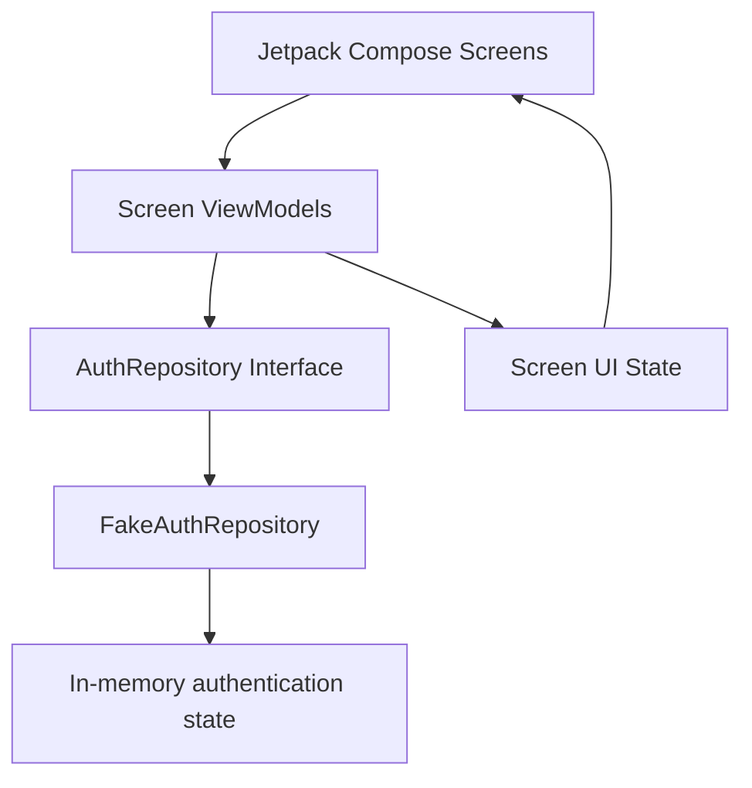
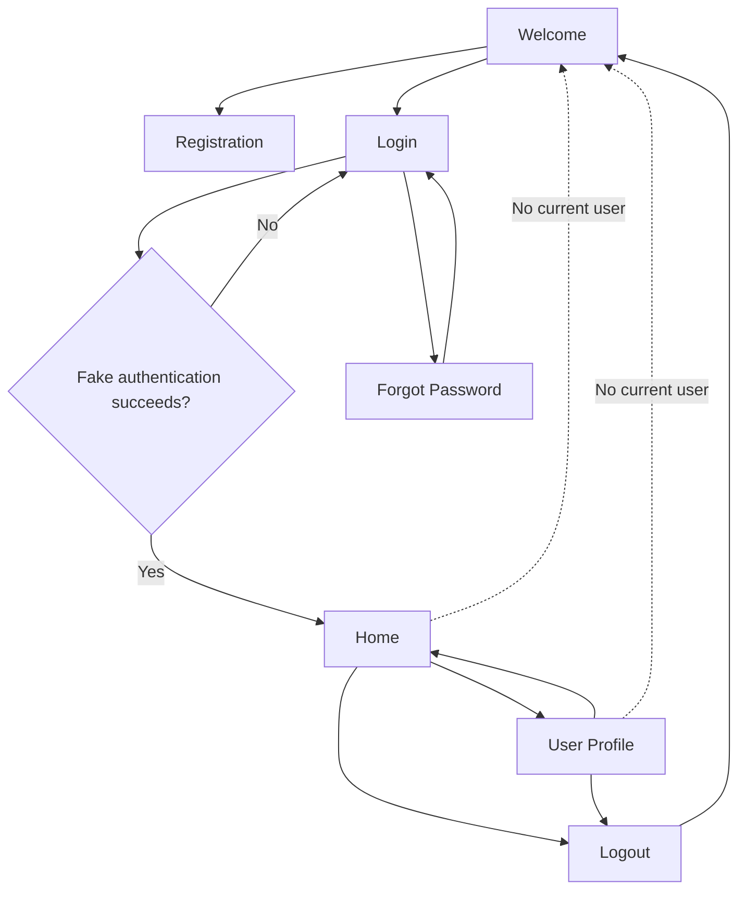

# NeuroVerse Auth App (ACT-3831)

An Android authentication application built with **Kotlin**, **Jetpack Compose**, **MVVM**, the **Repository pattern**, and **Kotlin Coroutines**.

> **Submission status: Partial submission**
>
> This README describes the current implementation status. The app currently uses an in-memory `FakeAuthRepository`; Firebase Authentication and persistent authentication sessions are still pending. Do not treat the planned Firebase functionality as implemented.

---

## 1. Project Overview

The NeuroVerse Auth App is an Android application developed for the authentication-system task issued by **NeuroVerse Software Solutions LLP** (Registration No. **ACT-3831**).

The current application provides the main authentication user-interface flows:

- Welcome
- User registration
- Login
- Forgot password
- Home
- User profile

The project is structured to separate the UI, business rules, and authentication data operations. This makes it easier to replace the current fake authentication implementation with a real authentication provider in a later phase.

## 2. Current Implementation Status

### Completed

| Area | Current implementation |
|---|---|
| Screens | Welcome, Registration, Login, Forgot Password, Home, and User Profile |
| UI | Jetpack Compose |
| Architecture | MVVM with Repository pattern |
| Asynchronous work | Kotlin Coroutines |
| Input validation | Name, email, and password validation |
| Password visibility | Show/hide password on the Login screen |
| Logout navigation | Logout returns the user to Welcome |
| Basic route guard | Home and Profile redirect to Welcome when there is no signed-in user in the current repository implementation |
| Forgot-password response | Neutral message that does not reveal whether an account exists |
| Unit tests | 85 tests reported passing with `./gradlew :app:testDebugUnitTest` |

### Pending

| Area | Current status |
|---|---|
| Firebase Authentication | Not integrated |
| Real account registration and login | Not implemented; current authentication uses an in-memory `FakeAuthRepository` |
| Persistent authentication session | Not implemented |
| Session restoration after app restart | Not implemented |
| Secure token storage | Not implemented |
| Full route protection | Requires a real authentication session |
| Device testing | Only Registration has been checked on a device; results for the remaining scenarios are not documented |
| Architecture documentation | Pending |
| Authentication-flow documentation | Pending |

**Important:** Because the current repository is in-memory, registered accounts and session state are not retained when the app process is restarted. The current route guard is therefore a basic UI/navigation check, not production-grade authentication protection.

## 3. Technology Stack

| Technology | Purpose |
|---|---|
| Kotlin | Primary application language |
| Android | Target platform |
| Jetpack Compose | Declarative UI toolkit |
| Material 3 | UI components and theming |
| MVVM | Presentation-layer architecture |
| Repository pattern | Separates authentication operations from UI code |
| Kotlin Coroutines | Asynchronous operations |
| StateFlow / UI state | Represents and exposes screen state where used |
| Navigation Compose | Navigation between application screens |
| JUnit and coroutine test utilities | Unit testing |

The exact dependency and plugin versions are maintained in the Gradle configuration files. Refer to those files for the versions used by the current checkout.

## 4. Application Screens and Flows

### Welcome

The entry screen provides navigation to Registration and Login. It is also the destination used after logout and when the basic route guard detects no signed-in user.

### Registration

The registration screen collects the user's name, email, and password. Input validation checks the required fields and enforces the current minimum password length of eight characters.

The current fake repository stores account information only in memory. Registration does not yet create a Firebase account.

### Login

The login screen accepts an email address and password. It validates input and provides a show/hide password control.

Authentication currently uses the fake in-memory repository. A successful fake login navigates to the authenticated part of the app according to the current app flow.

### Forgot Password

The screen accepts an email address and displays a neutral response. The response is designed not to disclose whether an account exists.

A real password-reset email cannot be sent until a real authentication provider, such as Firebase Authentication, is integrated.

### Home

The Home screen is the main screen shown after the current login flow succeeds. The basic route guard redirects to Welcome if the repository reports no signed-in user.

### User Profile

The Profile screen displays the available user information and provides a route back to Home and a logout action. Logout clears the current fake authentication state and returns the user to Welcome.

## 5. Architecture

The project follows an MVVM and Repository-based separation:



### Presentation layer

The presentation layer contains the Compose screens, ViewModels, and UI-state classes.

- **Screens** render the UI and forward user actions to their ViewModels.
- **ViewModels** coordinate screen actions, validation, repository calls, and state updates.
- **UI state** represents information that the screen needs to render, such as loading, user information, and messages.

### Domain layer

The domain layer contains the authentication contract, models, result/error types, and validation rules.

- `AuthRepository.kt` defines the operations expected by the application.
- `User.kt` represents the user data used by the app.
- `AuthResult.kt` represents successful and failed operation results.
- `AuthError.kt` represents authentication error categories.
- `Validators.kt` contains input-validation rules.

### Data layer

The data layer contains repository implementations.

- `FakeAuthRepository.kt` is the current in-memory implementation used by the app.
- `FirebaseAuthRepository.kt` is present in the project inventory, but the current submission status identifies Firebase integration as not completed. Its presence in the source tree must not be interpreted as proof that the app is using Firebase.

### Dependency setup

`AppContainer.kt` is part of the project and is used for application dependency setup. The current repository implementation and its wiring should be checked in the source code when changing the authentication provider.

## 6. Project Structure

The following structure is based on the project file inventory supplied for this README. It highlights the main source files and omits generated build output and resource detail.

```text
NeuroVerseAuthApp/
├── app/
│   ├── build.gradle.kts
│   └── src/
│       ├── main/
│       │   ├── AndroidManifest.xml
│       │   ├── java/com/neuroverse/authapp/
│       │   │   ├── MainActivity.kt
│       │   │   ├── AppContainer.kt
│       │   │   ├── data/
│       │   │   │   └── repository/
│       │   │   │       ├── FakeAuthRepository.kt
│       │   │   │       └── FirebaseAuthRepository.kt
│       │   │   ├── domain/
│       │   │   │   ├── model/
│       │   │   │   │   ├── AuthError.kt
│       │   │   │   │   ├── AuthResult.kt
│       │   │   │   │   └── User.kt
│       │   │   │   ├── repository/
│       │   │   │   │   └── AuthRepository.kt
│       │   │   │   └── validation/
│       │   │   │       └── Validators.kt
│       │   │   └── ui/
│       │   │       ├── common/
│       │   │       │   └── ErrorMessages.kt
│       │   │       ├── forgot/
│       │   │       │   ├── ForgotPasswordScreen.kt
│       │   │       │   ├── ForgotPasswordUiState.kt
│       │   │       │   └── ForgotPasswordViewModel.kt
│       │   │       ├── home/
│       │   │       │   ├── HomeScreen.kt
│       │   │       │   ├── HomeUiState.kt
│       │   │       │   └── HomeViewModel.kt
│       │   │       ├── login/
│       │   │       │   ├── LoginScreen.kt
│       │   │       │   ├── LoginUiState.kt
│       │   │       │   └── LoginViewModel.kt
│       │   │       ├── navigation/
│       │   │       │   ├── NavGraph.kt
│       │   │       │   └── Routes.kt
│       │   │       ├── profile/
│       │   │       │   ├── ProfileScreen.kt
│       │   │       │   ├── ProfileUiState.kt
│       │   │       │   └── ProfileViewModel.kt
│       │   │       ├── register/
│       │   │       │   ├── RegisterScreen.kt
│       │   │       │   ├── RegisterUiState.kt
│       │   │       │   └── RegisterViewModel.kt
│       │   │       ├── screens/
│       │   │       │   └── StubScreen.kt
│       │   │       ├── theme/
│       │   │       │   ├── Color.kt
│       │   │       │   ├── Theme.kt
│       │   │       │   └── Type.kt
│       │   │       └── welcome/
│       │   │           └── WelcomeScreen.kt
│       │   └── res/
│       └── test/java/com/neuroverse/authapp/
│           ├── data/repository/
│           │   └── FakeAuthRepositoryTest.kt
│           ├── domain/validation/
│           │   └── ValidatorsTest.kt
│           └── ui/
│               ├── forgot/ForgotPasswordViewModelTest.kt
│               ├── home/HomeViewModelTest.kt
│               ├── login/LoginViewModelTest.kt
│               ├── profile/ProfileViewModelTest.kt
│               └── register/RegisterViewModelTest.kt
├── gradle/
│   ├── libs.versions.toml
│   ├── gradle-daemon-jvm.properties
│   └── wrapper/
├── build.gradle.kts
├── settings.gradle.kts
├── gradle.properties
├── gradlew
└── README.md
```

## 7. Authentication Flow

The following diagram describes the intended/current screen flow. The current authentication decision is backed by the fake repository, not Firebase.



## 8. Requirements and Current Coverage

| Task requirement | Current coverage |
|---|---|
| Welcome screen | Implemented |
| Registration screen | Implemented |
| Login screen | Implemented |
| Forgot Password screen | Implemented |
| Home screen | Implemented |
| User Profile screen | Implemented |
| Required-field validation | Implemented |
| Email validation | Implemented |
| Password minimum length | Implemented; currently 8 characters |
| Show/hide password | Implemented on Login |
| Duplicate email handling | Depends on fake repository behavior; real provider validation is pending |
| Real account creation and login | Pending |
| Password-reset email | Pending |
| Session persistence after restart | Pending |
| Secure token storage | Pending |
| Protected authenticated routes | Basic UI guard only; full protection pending |
| Logout | Current fake session is cleared and navigation returns to Welcome |
| Automated unit tests | 85 tests reported passing |
| Device test evidence for all scenarios | Pending |
| Architecture and auth-flow documents | Pending |

## 9. Build and Run

### Prerequisites

- Android Studio
- Android SDK and a compatible JDK configured for the project
- An Android emulator or physical Android device

### Open the project

1. Open Android Studio.
2. Select **Open** and choose the `NeuroVerseAuthApp` project directory.
3. Allow Gradle sync to complete.
4. Run the `app` configuration on an emulator or connected device.

### Build a debug APK

From the project root:

```bash
./gradlew :app:assembleDebug
```

The generated APK is expected at:

```text
app/build/outputs/apk/debug/app-debug.apk
```

### Run unit tests

```bash
./gradlew :app:testDebugUnitTest
```

The project status supplied for this README reports **85 passing unit tests**. Run the command again on the current checkout to confirm the result.

## 10. Testing

### Automated tests

The supplied project inventory includes tests for:

- Input validation
- Fake authentication repository behavior
- Registration ViewModel
- Login ViewModel
- Forgot Password ViewModel
- Home ViewModel
- Profile ViewModel

Reported command:

```bash
./gradlew :app:testDebugUnitTest
```

Reported result: **85 tests passing**. This is the result provided for the project; it has not been independently rerun while preparing this README.

### Device testing status

Only Registration has been checked on a physical device according to the supplied status. The remaining scenarios still need to be tested and documented.

Recommended device-test checklist:

| # | Scenario | Status |
|---:|---|---|
| 1 | Register with valid details | Checked on device (as reported) |
| 2 | Attempt registration with an already-used email | Pending |
| 3 | Login with valid credentials | Pending |
| 4 | Login with invalid credentials | Pending |
| 5 | Submit empty or invalid input | Pending |
| 6 | Submit a password-reset request | Pending; real email flow requires provider integration |
| 7 | Restart the app and verify session restoration | Pending; persistence is not implemented |
| 8 | Open Home/Profile without an authenticated user | Pending device evidence; basic route guard exists |
| 9 | Logout and verify return to Welcome | Pending device evidence |
| 10 | Test network/authentication failure handling | Pending; real provider integration is not complete |

Record the device model, Android version, test date, steps, expected result, actual result, and pass/fail status when completing these tests.

## 11. Configuration and Firebase Integration

The current app does **not** require Firebase configuration to run with the fake in-memory repository.

Firebase Authentication is a planned integration, not a completed feature. When implementing it:

1. Confirm that Firebase Email/Password authentication is the approved provider and that the approach is accepted by NeuroVerse.
2. Register the Android application in the relevant Firebase project.
3. Add the appropriate `google-services.json` to the `app/` directory.
4. Keep the configuration file out of source control if required by the project's security and repository policy.
5. Add and verify the required Gradle plugin and Firebase Authentication dependencies.
6. Implement the real repository operations behind the existing `AuthRepository` contract.
7. Wire the real implementation through the app's dependency setup.
8. Verify registration, login, duplicate-account errors, password reset, session restoration, logout, and failure handling on a device.

Do not mark Firebase integration complete until the application is wired to the real provider and the flows have been tested.

## 12. Security Considerations

The current fake repository is suitable for demonstrating UI and basic application flow, but it is not a production authentication system.

Before a production-ready or final authenticated submission:

- Replace the in-memory fake repository with a real authentication provider.
- Never store plaintext passwords.
- Do not hardcode private credentials, API secrets, or service-account keys.
- Use the provider's supported session handling and secure storage mechanisms.
- Restore and validate the authentication state when the app starts.
- Ensure authenticated destinations are controlled by the real session state.
- Clear the local authentication state on logout.
- Display safe, user-friendly authentication errors.
- Avoid exposing account-existence information in password-reset responses.
- Test behavior during network failures and expired or invalid sessions.

A basic navigation redirect is not a substitute for backend authorization. Any protected server-side data must also be protected by the backend/provider.

## 13. Known Limitations

1. **In-memory accounts:** User accounts created through the fake repository are lost when the app process is restarted.
2. **No real authentication provider:** Firebase Authentication is not yet integrated into the running application.
3. **No persistent session:** The app does not currently restore a real authenticated session after restart.
4. **No secure token-storage implementation:** This remains pending with real authentication integration.
5. **Basic route guard only:** Current navigation checks do not provide production-grade route or data protection.
6. **Incomplete device verification:** Device results are documented only for Registration so far.
7. **Pending supporting documents:** Separate architecture and authentication-flow documents have not yet been completed.

## 14. Suggested Completion Order

To complete the pending work without unnecessarily changing the existing architecture:

1. Confirm the authentication provider and assumptions with NeuroVerse.
2. Complete the real authentication repository and dependency wiring.
3. Verify registration, duplicate email, login, and safe error handling.
4. Implement and test password reset.
5. Implement persistent session restoration and logout behavior using the provider's supported mechanisms.
6. Ensure Home and Profile respond correctly to the real authentication state.
7. Run unit tests and complete the device-test checklist.
8. Prepare architecture and authentication-flow documentation.
9. Build and verify the final APK and prepare the source repository for submission.

## 15. Submission Deliverables

| Deliverable | Status |
|---|---|
| Kotlin Android source code | Available in project |
| Six application screens | Implemented |
| Authentication flows | Partial; fake repository currently used |
| Persistent session management | Pending |
| Secure real authentication | Pending |
| Unit tests | 85 passing, as reported |
| Device testing results | Partial |
| README | This document |
| Architecture documentation | Pending |
| Authentication-flow documentation | Pending |
| Debug APK | Can be generated using the build command above |

---

## 16. Project Notes

- Project name: **NeuroVerse Auth App**
- Organization: **NeuroVerse Software Solutions LLP**
- Current authentication implementation: **In-memory FakeAuthRepository**
- Planned provider assumption: **Firebase Authentication (Email/Password), not yet approved or integrated**
- Current password-length rule: **Minimum 8 characters**

This README reflects the status information supplied for the project. Update the status tables and test results as implementation and verification are completed.
